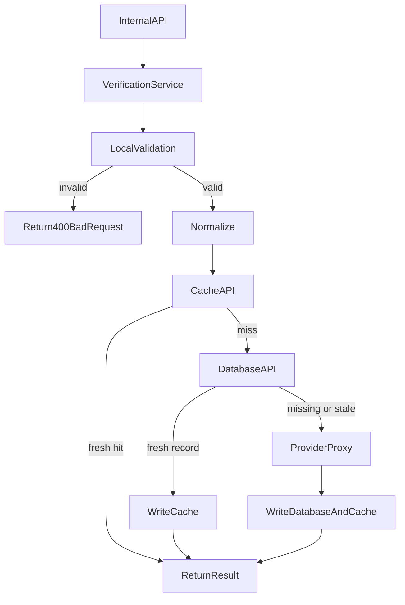
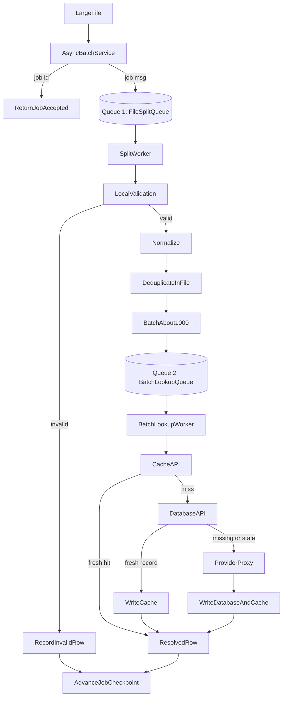
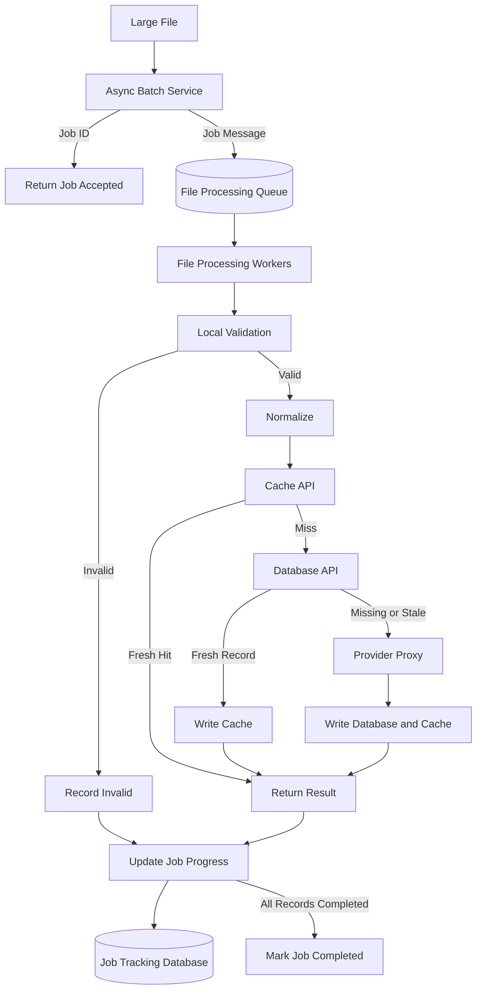
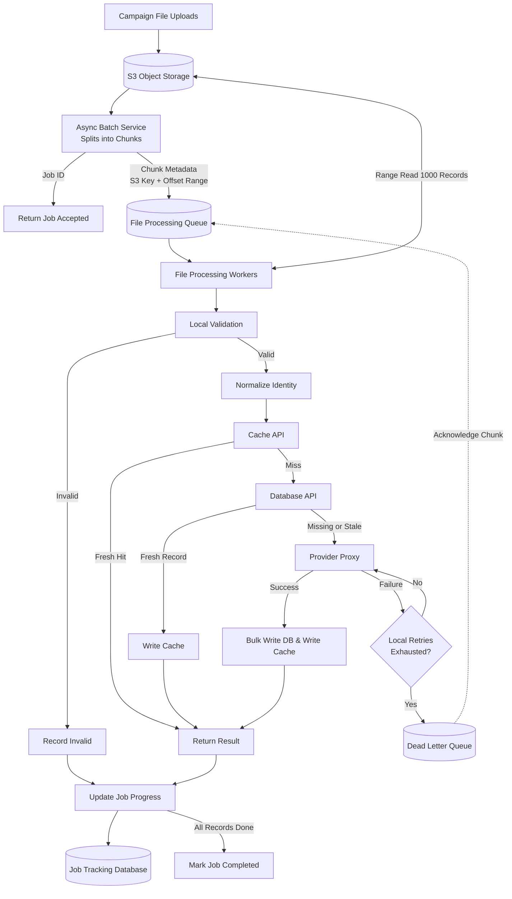

# Verification Service

> **v1 scope.** This README is the design background. It describes the full design, including a cache, batch jobs and queues. **v1 has none of these.** The v1 flow is: validate, normalize, read the database, call the provider only on a miss or stale record. [TEAM_PLAN.md](TEAM_PLAN.md) is the source of truth for v1. Wherever this document mentions a cache, treat it as v2.

Internal APIs call this service to check a mobile number or an email address. The service validates the input locally, then looks up a stored result in the cache and, on a miss, in the database. The provider proxy runs only when both are missing a fresh result. Cache and database calls go to internal APIs. The proxy is only the call that fetches from Twilio or SendGrid, and it keeps the provider credentials, rate limits, and access checks.

References used by this design:

- [Twilio Lookup v2](https://www.twilio.com/docs/lookup/v2-api) for phone lookups
- [Lookup pricing](https://www.twilio.com/en-us/lookup/pricing) for which phone packages are free or paid
- [libphonenumber](https://github.com/google/libphonenumber) for local phone parsing and validation
- [SendGrid Email Address Validation](https://www.twilio.com/docs/sendgrid/api-reference/email-address-validation/validate-an-email) for email checks

## Scope

The first version covers:

- Accepting a phone number or an email from an internal API
- Rejecting input that fails local validation, with no cache, database, or proxy call
- Reading a fresh result from the cache, then from the database
- Calling the provider proxy only when neither has a fresh result
- Writing that result to the database and the cache before returning it
- Accepting a large CSV or JSON file as a background job that reuses the same lookup path in chunks

The database remains the source of truth. The cache holds a copy for the freshness window. This service looks up an identity and reuses that lookup. Sending a one-time password, or proving the caller controls the phone or inbox, is outside this service.

## Architecture

A single check and a large file share the same lookup steps: validate, normalize, cache, database, and the provider proxy only when both stores miss. The single check runs those steps on the request thread. The file is accepted as a job and a worker runs the steps later.

### Single check



`VerificationService` handles the request directly. There is no worker. Local validation rejects a blank or unparsable value with HTTP 400 before any remote call. A value that passes is normalized: a phone number to E.164, an email to the trimmed address used as the stored identity. That normalized value is the cache key, the database `_id`, and the value sent to the proxy.

Cache and database access are direct calls to internal APIs. The proxy is not on that path. It runs only after a cache miss and a database miss or stale record, and its only job is to fetch from the provider: Twilio Lookup for a phone number, SendGrid Email Validation for an email. The service then writes that response to the database and the cache and returns it.

### Batch



### Alternative 1



### Alternative 2


`AsyncBatchService` stores the CSV or JSON file, returns a job id on the upload request, and publishes a single job message to **Queue 1** (`FileSplitQueue`).

**Queue 1 (`FileSplitQueue` — File Splitting & Normalization):** A `SplitWorker` consumes the job message and streams the file row by row. Each row is validated and normalized the same way as a single check. Invalid rows are recorded on the job and skipped. Valid normalized values are deduplicated in memory for that file and grouped into batches of about 1000, which are published to **Queue 2** (`BatchLookupQueue`).

**Queue 2 (`BatchLookupQueue` — Parallel Lookup Processing):** `BatchLookupWorker` instances pull batches in parallel and run the same lookup path as a single check: reading the cache, falling back to the database on a miss, and calling the provider proxy only when both miss or the database record is stale. Proxy calls run under a rate limit so a large file cannot exhaust the provider budget. Each proxy result is written to the database and the cache before advancing the job checkpoint, allowing a restarted worker to resume from the last saved checkpoint.

## Phone numbers

1. Parse the input with libphonenumber.
2. Reject numbers that fail validation with HTTP 400 and an `ApiError` body. Do not call the cache, the database, or the proxy.
3. Normalize a valid number to E.164. That string is the cache key, the database `_id`, and the value sent to the proxy.
4. Read the cache through the internal cache API. A fresh hit is returned as-is.
5. On a cache miss, read `phone_lookups` through the internal database API. A fresh document is written back to the cache and returned.
6. When the database has no document, or the document is past the freshness window, call the phone proxy. The proxy calls [Twilio Lookup v2](https://www.twilio.com/docs/lookup/v2-api).
7. Write the proxy result to the database and the cache, then return it.

libphonenumber supplies the region, the national and E.164 forms, and a number type such as mobile or fixed line. Lookup v2 Basic formatting and validation is free and is returned on every call. Carrier, line type, and the other signals are separate paid packages, selected with the `Fields` query parameter.

## Email addresses

Email uses the same order: local validation, normalization, cache, database, then the provider proxy.

Lookup v2 is a phone API. The email proxy calls [SendGrid Email Address Validation](https://www.twilio.com/docs/sendgrid/api-reference/email-address-validation/validate-an-email). That API needs an Email API Pro or Premier plan and an Email Validation API key, separate from the Twilio Lookup credentials. Cache and database calls stay on the internal APIs and do not go through this proxy.

Normalization for email is lowercase, trimmed local-part and domain, with surrounding whitespace removed. The normalized address is the stored identity.

## Phone lookup request and response

The proxy sends:

```bash
curl -X GET "https://lookups.twilio.com/v2/PhoneNumbers/%2B14159929960?Fields=line_type_intelligence" \
  -u "$TWILIO_API_KEY:$TWILIO_API_SECRET"
```

Authentication is the Twilio API key SID and secret. `Fields` is optional. Omitting it returns the free Basic lookup. A comma-separated list requests several packages on one call, and each named package is billed on its own. A trial account can request packages inside its Lookup quota. Some packages also need carrier approval or a regional allowlist on the Twilio account. The proxy owns that allowlist and sends only packages this service asks for.

### Request parameters

| Parameter | In | Required | Purpose |
| --- | --- | --- | --- |
| `PhoneNumber` | path | yes | Number in E.164 or national format. National format defaults to country code `+1` unless `CountryCode` is set. |
| `Fields` | query | no | Comma-separated package names. Basic formatting and validation still come back when this is set. |
| `CountryCode` | query | no | ISO country code used when `PhoneNumber` is in national format. |

Other query parameters exist for specific packages and are sent only when that package is requested: name, address, date of birth, and national ID for `identity_match`; `LastVerifiedDate` for `reassigned_number`; `VerificationSid` for `pre_fill`; `PartnerSubId` for `sms_pumping_risk`. Those inputs are request-specific. This service keeps them out of the stored phone record.

### Packages

Prices are from the [Lookup pricing page](https://www.twilio.com/en-us/lookup/pricing) as of October 2026. Volume tiers can lower some of them.

| `Fields` value | Cost | Response object |
| --- | --- | --- |
| omitted | Free | Basic fields only. Package objects are `null`. |
| `line_type_intelligence` | $0.008 / request | `type`, `carrier_name`, `mobile_country_code`, `mobile_network_code`, `error_code` |
| `line_status` | $0.007 / request, tiered | `status`, `error_code` |
| `sms_pumping_risk` | Free in North America, $0.025 elsewhere | `carrier_risk_category`, `number_blocked`, `number_blocked_date`, `number_blocked_last_3_months`, `sms_pumping_risk_score`, `error_code` |
| `caller_name` | $0.01 / request, US carriers | `caller_name`, `caller_type`, `error_code` |
| `reassigned_number` | $0.02 / request, tiered, US only | `last_verified_date`, `is_number_reassigned`, `error_code` |
| `identity_match` | $0.10 / request, varies by country | Per-field match results plus `summary_score` |
| `sim_swap` | Contact sales, private beta | `last_sim_swap`, `carrier_name`, `mobile_country_code`, `mobile_network_code`, `error_code` |
| `call_forwarding` | Contact sales, private beta, major UK carriers | `call_forwarding_enabled`, `error_code` |

`line_type` values include `mobile`, `landline`, `fixedVoip`, `nonFixedVoip`, `personal`, `tollFree`, `premium`, `sharedCost`, `uan`, `voicemail`, `pager`, and `unknown`. For a mobile check, the proxy requests `line_type_intelligence`. `type` equals `mobile` when the number is a mobile line. Carrier fields are null for several non-mobile types, including `tollFree` and `unknown`.

### Response fields present on every call

| Field | Meaning |
| --- | --- |
| `calling_country_code` | International dialing prefix, such as `1`. |
| `country_code` | ISO country code, such as `US`. |
| `phone_number` | E.164 form. |
| `national_format` | National formatting. |
| `valid` | The number is in a range a carrier can assign. This is separate from line type and from whether the line is active. |
| `validation_errors` | `null` when valid. Otherwise one or more of `TOO_SHORT`, `TOO_LONG`, `INVALID_BUT_POSSIBLE`, `INVALID_COUNTRY_CODE`, `INVALID_LENGTH`, `NOT_A_NUMBER`. |
| package objects | `null` unless that package name was included in `Fields`. |
| `url` | Lookup URL for the number. Left out of storage. |

### Example: Basic lookup, valid number

Documented response for `GET /v2/PhoneNumbers/+14159929960` with no `Fields`:

```json
{
  "calling_country_code": "1",
  "country_code": "US",
  "phone_number": "+14159929960",
  "national_format": "(415) 992-9960",
  "valid": true,
  "validation_errors": null,
  "caller_name": null,
  "sim_swap": null,
  "call_forwarding": null,
  "line_status": null,
  "line_type_intelligence": null,
  "identity_match": null,
  "reassigned_number": null,
  "sms_pumping_risk": null,
  "phone_number_quality_score": null,
  "pre_fill": null,
  "url": "https://lookups.twilio.com/v2/PhoneNumbers/+14159929960"
}
```

### Example: Basic lookup, invalid number

Documented response for `+141599299600`:

```json
{
  "calling_country_code": null,
  "country_code": null,
  "phone_number": "+141599299600",
  "national_format": null,
  "valid": false,
  "validation_errors": ["TOO_LONG"],
  "caller_name": null,
  "sim_swap": null,
  "call_forwarding": null,
  "line_status": null,
  "line_type_intelligence": null,
  "identity_match": null,
  "reassigned_number": null,
  "sms_pumping_risk": null,
  "phone_number_quality_score": null,
  "pre_fill": null,
  "url": "https://lookups.twilio.com/v2/PhoneNumbers/+141599299600"
}
```

libphonenumber rejects this shape locally, so the proxy is not called for it. The example shows what Twilio returns if a number does reach Lookup.

### Example: line type intelligence

Documented response for `Fields=line_type_intelligence`. Unrequested package objects are omitted here for length. Twilio still returns them as `null`.

```json
{
  "calling_country_code": "1",
  "country_code": "US",
  "phone_number": "+14159929960",
  "national_format": "(415) 992-9960",
  "valid": true,
  "validation_errors": null,
  "line_type_intelligence": {
    "error_code": null,
    "mobile_country_code": "240",
    "mobile_network_code": "38",
    "carrier_name": "Twilio - SMS/MMS-SVR",
    "type": "nonFixedVoip"
  },
  "url": "https://lookups.twilio.com/v2/PhoneNumbers/+14159929960"
}
```

## Email validation request and response

The email proxy sends:

```bash
curl -X POST "https://api.sendgrid.com/v3/validations/email" \
  --header "Authorization: Bearer $SENDGRID_API_KEY" \
  --header "Content-Type: application/json" \
  --data '{"email": "cedric@fogowl.com", "source": "signup"}'
```

### Request body

| Field | Required | Purpose |
| --- | --- | --- |
| `email` | yes | Address to validate. |
| `source` | no | One-word label for where the check came from. Letters, numbers, and spaces only. An account can track up to 50 sources. This service passes a fixed label for the calling internal API, such as `signup`. |

### Response fields

The body is a `result` object.

| Field | Meaning |
| --- | --- |
| `email` | Address that was validated. |
| `verdict` | `Valid`, `Risky`, or `Invalid`. |
| `score` | Number from 0 to 1. Higher means more likely to be deliverable. |
| `local` | Local part, before `@`. |
| `host` | Domain. |
| `suggestion` | Present when the domain looks like a typo, such as `gmial.com`. |
| `checks.domain.has_valid_address_syntax` | Syntax is acceptable. |
| `checks.domain.has_mx_or_a_record` | Domain has DNS records that can accept mail. |
| `checks.domain.is_suspected_disposable_address` | Domain looks like a disposable mail service. |
| `checks.local_part.is_suspected_role_address` | Local part looks like a group address, such as `admin` or `hr`. |
| `checks.additional.has_known_bounces` | Mail from this SendGrid account has bounced for this address. |
| `checks.additional.has_suspected_bounces` | The model expects a bounce. |
| `ip_address` | IP associated with the check. Left out of storage. |
| `source` | Echo of the request `source`, when one was sent. |

`Risky` is a real verdict. A role address or a disposable domain is classified as risky, with a score around 0.5. The stored record keeps `verdict` and `score` rather than collapsing them to a boolean.

### Example: documented valid response

```json
{
  "result": {
    "email": "cedric@fogowl.com",
    "verdict": "Valid",
    "score": 0.85021,
    "local": "cedric",
    "host": "fogowl.com",
    "checks": {
      "domain": {
        "has_valid_address_syntax": true,
        "has_mx_or_a_record": true,
        "is_suspected_disposable_address": false
      },
      "local_part": {
        "is_suspected_role_address": false
      },
      "additional": {
        "has_known_bounces": false,
        "has_suspected_bounces": false
      }
    },
    "ip_address": "192.168.1.1"
  }
}
```

## Persistence

The durable store is a document database, reached through an internal database API. Each check is a single read by identity, and the two channels do not share a row shape. The cache, reached through an internal cache API, is checked first and holds the same document for the freshness window. A cache hit does not read the database. A database hit after a cache miss refreshes the cache. The proxy result is written to the database first, then to the cache.

Reasons for that choice:

- The read path is one get by normalized phone number or normalized email. The cache is tried first. The database is the same key lookup, followed by a comparison of `checked_at` with the freshness window.
- A phone document and an email document carry different fields. Lookup packages add nested objects. Email carries a verdict, a score, and a checks tree. One shared table of columns would be sparse on both sides.
- New `Fields` packages can be stored inside `result` without a schema migration.
- A phone record has no relation to an email record, so there is nothing to join.
- A `null` package on the Twilio payload can mean "not requested" or "requested and empty". The stored document keeps a `packages` list of what was asked for, next to the nested result.

Two collections:

- `phone_lookups`, keyed by E.164
- `email_lookups`, keyed by the normalized address

Each collection holds one current document per identity. A fresh document is returned as-is. A missing or stale document is replaced after the proxy call succeeds.

Promoted fields are the ones used to filter or decide freshness: the identity, `checked_at`, `packages`, and `valid` or `verdict` plus `score`. The rest of the provider payload stays nested in `result`.

A record is fresh until a configurable window elapses. Carrier, line type, and mailbox signals change, so a stale record triggers a new proxy call. Phone and email can use different windows. If the company database standard is already a relational engine, the same documents can live as two tables with a JSON column for `result` and indexes on the promoted fields. The access pattern stays a key lookup.

`identity_match` inputs, `pre_fill`, and the email `ip_address` stay out of these collections.

### Stored phone document

Built from the line-type example above. `is_mobile` is true only when `line_type_intelligence.type` is `mobile`.

```json
{
  "_id": "+14159929960",
  "channel": "phone",
  "checked_at": "2026-11-17T11:37:00Z",
  "source": "phone-proxy",
  "packages": ["line_type_intelligence"],
  "valid": true,
  "is_mobile": false,
  "result": {
    "calling_country_code": "1",
    "country_code": "US",
    "national_format": "(415) 992-9960",
    "validation_errors": null,
    "line_type_intelligence": {
      "type": "nonFixedVoip",
      "carrier_name": "Twilio - SMS/MMS-SVR",
      "mobile_country_code": "240",
      "mobile_network_code": "38",
      "error_code": null
    }
  }
}
```

### Stored email document

Built from the documented SendGrid response. The key is the normalized address.

```json
{
  "_id": "cedric@fogowl.com",
  "channel": "email",
  "checked_at": "2026-11-17T11:40:00Z",
  "source": "signup",
  "verdict": "Valid",
  "score": 0.85021,
  "result": {
    "local": "cedric",
    "host": "fogowl.com",
    "checks": {
      "domain": {
        "has_valid_address_syntax": true,
        "has_mx_or_a_record": true,
        "is_suspected_disposable_address": false
      },
      "local_part": {
        "is_suspected_role_address": false
      },
      "additional": {
        "has_known_bounces": false,
        "has_suspected_bounces": false
      }
    }
  }
}
```

## Cost control

Paid calls are the exception.

- Invalid phone numbers and emails are rejected locally and are not sent to the cache, the database, or the proxy.
- A fresh cache hit is returned with no database read and no proxy call.
- A fresh database record is returned with no proxy call, and it is written into the cache.
- The phone proxy sends `Fields` only for packages the caller needs. Basic formatting is free. Each named package is a separate charge.
- Concurrent requests for the same normalized identity share one in-flight proxy call. Later arrivals wait for that call and then read the stored result, so the same identity is not billed twice at the same time.
- The proxy remains responsible for provider rate limits and quotas. This service still withholds calls it can answer from storage.

## Errors

| Situation | Behavior |
| --- | --- |
| Phone number fails libphonenumber validation | Return HTTP 400 with an `ApiError` body. Do not call the cache, the database, or the proxy. |
| Email fails basic normalization | Return HTTP 400 with an `ApiError` body. Do not call the cache, the database, or the proxy. |
| Cache holds a fresh record | Return the cached record. |
| Cache misses and the database holds a fresh record | Return the database record and write it to the cache. |
| Both miss, or the database record is stale, and the proxy succeeds | Write the new result to the database and the cache, then return it. |
| Proxy fails and an older record exists | Return the older record and mark it stale, so the caller can tell it was not refreshed. |
| Proxy fails and no record exists | Return an error from the proxy. Leave nothing stored for that attempt. |
| Proxy responds with a rate limit | Surface that response. Do not retry in a tight loop. |

## Privacy

Phone numbers and email addresses are personal data. Store the normalized identity and the lookup fields callers need, together with the time and source of the lookup. Provider credentials stay on the proxy. Access to this service stays on the internal network, limited to the APIs that are allowed to request a check.

## Cache (v2, not in v1)

The cache sits in front of the database on every request that passes local validation. This service calls it through an internal cache API, using the same key as the database `_id`: the E.164 string or the normalized email.

A cache entry lives for the freshness window. A hit is returned immediately. A miss, or an expired entry, falls through to the database. The database stays the source of truth, including when the proxy fails and an older database document is returned as stale. A successful proxy call updates the database, then the cache, so the next request for that identity stops at the cache.

---

## Developer guide (v1)

This section covers running and working on the service. The design above is background; [TEAM_PLAN.md](TEAM_PLAN.md) is the source of truth for v1.

### Requirements

- Java 17
- Docker (for the Testcontainers tests and for a local MongoDB)
- No local Maven install needed. Use `./mvnw`.

### Running locally

The service needs MongoDB. The default URI is in [src/main/resources/application.properties](src/main/resources/application.properties). Override it with the `MONGODB_URI` environment variable:

```bash
MONGODB_URI="mongodb://localhost:27017/lookup_local" ./mvnw spring-boot:run
```

Actuator exposes `health` and `info` at `/actuator/health` and `/actuator/info`.

### Running tests

Docker must be running. The tests start `mongo:7.0` through Testcontainers and set the mock provider failure rates to zero.

```bash
./mvnw clean verify
```

Mongo integration tests will extend a shared base class, `AbstractMongoIntegrationTest`, in `src/test/java/com/twilio/lookup/`, once it is added. Do not add a test copy of `application.properties`, because it would shadow the main one.

### What is stored

`PhoneLookup.result` (`PhoneResult`) holds the basic Lookup v2 fields plus one optional object per data package: `line_type_intelligence`, `line_status`, `caller_name`, `sim_swap`, `call_forwarding`, `reassigned_number`, `sms_pumping_risk` and `phone_number_quality_score`. A package object is `null` unless that package was requested, so the stored document stays small. Adding a package needs no Mongo migration.

`EmailLookup.result` (`EmailResult`) holds every field SendGrid returns that we keep: `local`, `host`, `suggestion` and the three `checks` groups, with `verdict` and `score` on the document itself.

Not stored, to protect privacy and per the team plan: `identity_match` and `pre_fill` results, the phone `url`, the email `ip_address`, and the echoed email `source`. The phone number and email address are the document `_id`, so they are not repeated in `result`.

### Package overview

| Package | Contents | Owner |
| --- | --- | --- |
| `com.twilio.lookup` | `LookupServiceApplication` | Member 3 |
| `config` | `LookupProperties` (`lookup.*`), `MongoConfig` (auditing), `ClockConfig` (`Clock` bean) | Member 3 |
| `dto` | `LookupStatus`, `LookupSource`, request and response DTOs | Members 1 and 2 (responses), Member 3 (enums) |
| `model` | `PhoneLookup`, `EmailLookup` and nested result types (Mongo mapping) | Member 3 |
| `repository` | `PhoneLookupRepository`, `EmailLookupRepository` | Member 3 |
| `service` | `StalenessPolicy`; lookup services | Member 3 (policy), Members 1 and 2 (lookup services) |
| `controller` | `PhoneLookupController`, `EmailLookupController` | Members 1 and 2 |
| `util` | `PhoneNormalizer`, `EmailNormalizer` | Members 1 and 2 |
| `provider` | Provider interfaces, response records, mappers, mock providers | Member 4 |
| `exception` | Provider and lookup exceptions, `ApiError`, `GlobalExceptionHandler` | Member 4 |

### Ownership

Only edit files your member owns. If you need a change elsewhere, raise it with the owner or send them a small PR.

| Area | Owner |
| --- | --- |
| Phone slice (`PhoneLookupController`, `PhoneLookupRequest`, `PhoneLookupResponse`, `PhoneNormalizer`, `PhoneLookupService`) | Member 1 |
| Email slice (`EmailLookupController`, `EmailLookupRequest`, `EmailLookupResponse`, `EmailNormalizer`, `EmailLookupService`) | Member 2 |
| Foundation (`pom.xml`, `application.properties`, `LookupServiceApplication`, `config/LookupProperties`, `config/MongoConfig`, `config/ClockConfig`, `dto/LookupStatus`, `dto/LookupSource`, `model/*`, `repository/*`, `service/StalenessPolicy`, test base class, this README section) | Member 3 |
| Providers and errors (`provider/*`, `config/ProviderProperties`, `exception/*`, `dto/ApiError`, `GlobalExceptionHandler`, `config/LookupLoggingAdvice`, actuator health) | Member 4 |

Review pairs: 1 reviews 2, 2 reviews 1, 3 reviews 4, 4 reviews 3.
