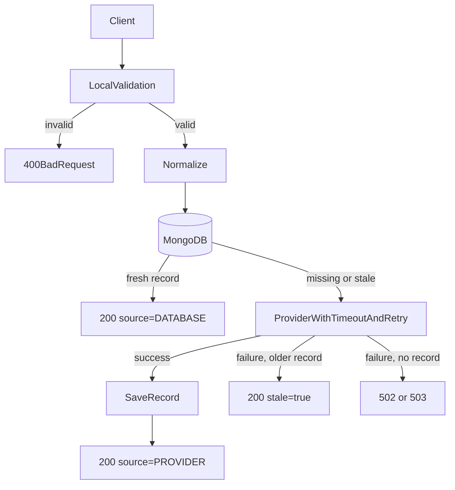

# Twilio Lookup Service

A Spring Boot service that checks a phone number or an email address. It validates the input locally, reads the stored result from MongoDB, and calls the provider only when there is no fresh record.

This branch (`scaffold`) is the complete architecture for a **single request**. The batch phone-number feature lives on `main`, in the separate `phonelookup/` project, and is not part of this code.

## Features

- Two endpoints: `POST /api/v1/lookups/phone` and `POST /api/v1/lookups/email`.
- Local validation before any remote call. Phone numbers go through libphonenumber and are normalized to E.164. Emails are trimmed and lowercased. Invalid input returns `400` and nothing is stored.
- MongoDB persistence, one document per identity (`phone_lookups`, `email_lookups`). A record is fresh for `lookup.staleness-ttl-days` (30 by default).
- Provider calls only on a miss or a stale record. The provider is a mock in this build, behind interfaces that the real Twilio and SendGrid clients will implement.
- Timeout and retry on every provider call: exponential backoff with jitter, and only transient failures are retried.
- Stale fallback: if the provider fails and an older record exists, that record is returned with `stale=true`.
- In-process per-key lock, so concurrent requests for the same number or email trigger one provider call.
- One JSON error shape (`ApiError`) for every failure.
- Simple test pages at `/`, `/phone` and `/email`, plus Actuator `health` and `info`.

## Request flow



## API

| Endpoint | Request body |
| --- | --- |
| `POST /api/v1/lookups/phone` | `phoneNumber` (required), `countryCode` (optional, two-letter ISO) |
| `POST /api/v1/lookups/email` | `email` (required) |

| Status | When |
| --- | --- |
| `200` | Lookup succeeded, including a provider verdict of invalid. `source` is `DATABASE` or `PROVIDER`, and `stale` is `true` when an older record was returned because the provider failed. |
| `400` | Bean validation failed, the body is malformed, or the number or email does not normalize. |
| `502` | Permanent provider error and no stored record. |
| `503` | Transient provider error after retries and no stored record. |
| `500` | Anything else. |

```bash
curl -X POST http://localhost:8080/api/v1/lookups/phone \
  -H "Content-Type: application/json" \
  -d '{"phoneNumber": "+14159929960"}'
```

The response carries `normalizedNumber`, `status`, `source`, `valid`, `callingCountryCode`, `countryCode`, `nationalFormat`, `validationErrors`, `lineType`, `carrier`, `mobile`, `packages`, `stale` and `checkedAt`. The email response carries `normalizedEmail`, `status`, `source`, `verdict`, `score`, `local`, `host`, `suggestion`, `checks`, `stale` and `checkedAt`. Errors use `timestamp`, `status`, `error`, `message` and `path`.

## Implementation

Java 17, Spring Boot 4.2.0, Maven, Spring Data MongoDB, libphonenumber 9.0.44, Testcontainers.

| Package (`com.twilio.lookup`) | Contents |
| --- | --- |
| `controller` | `PhoneLookupController`, `EmailLookupController` |
| `service` | `PhoneLookupService`, `EmailLookupService`, `StalenessPolicy`, `KeyLock`, `PhoneResponseAssembler` |
| `util` | `PhoneNormalizer`, `EmailNormalizer` |
| `model`, `repository` | Mongo documents and repositories |
| `provider` | Provider interfaces, mock providers, mappers, `ResilientCall` (timeout and retry) |
| `exception` | Provider and lookup exceptions, `GlobalExceptionHandler` |
| `dto`, `config` | Request and response DTOs, `ApiError`, configuration properties |

Settings are in [application.properties](src/main/resources/application.properties): `lookup.staleness-ttl-days`, `provider.timeout-ms`, `provider.retry.*` and `provider.mock.*` (failure rates and latency of the mock provider).

## Getting started

Requirements: Java 17 and Docker. Use the bundled `./mvnw`, so no local Maven is needed.

```bash
# Run against a local MongoDB (override the default URI if needed)
MONGODB_URI="mongodb://localhost:27017/lookup_local" ./mvnw spring-boot:run

# Build and run all tests (Docker must be running; Testcontainers starts mongo:7.0)
./mvnw clean verify
```

Then open `http://localhost:8080/`, or check `http://localhost:8080/actuator/health`.

## Documentation

- [docs/DESIGN.md](docs/DESIGN.md): design background, provider request and response details, storage model, error handling, developer guide, and the future cache and batch designs.
- [docs/UNSUPPORTED_PACKAGES.md](docs/UNSUPPORTED_PACKAGES.md): how a requested data package that Twilio cannot provide (for example, an unsupported country) is stored and reported, and how to verify it.
- [docs/TEAM_PLAN.md](docs/TEAM_PLAN.md): build contracts and ownership for the four-member team.
- [AGENTS.md](AGENTS.md): instructions for each member's coding agent.
